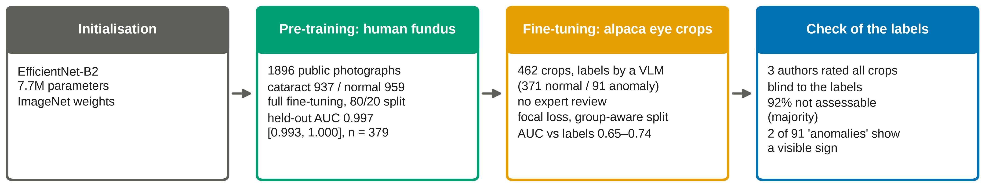
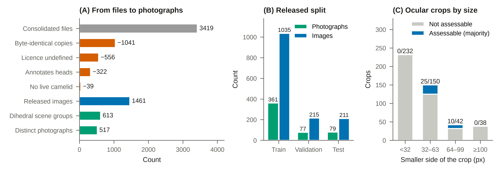

# AlpacaVision: near-duplicate leakage and auto-label reliability

Code, audit tools and results for an openly licensed detection benchmark of alpacas and other
South American camelids, assembled from public Roboflow Universe projects and audited for
licence, label format, exact duplicates, near-duplicates and content.

[](https://doi.org/10.5281/zenodo.23579349)
[](LICENSE)
[](#data)
[](https://www.python.org/)
[](https://paqocha.ginit.dev)

Companion code for the manuscript *Near-Duplicate Leakage and Auto-Label Reliability in Image
Datasets Assembled From Public Sources: An Audited Benchmark for Alpaca Detection* (under review
at *IEEE Access*, manuscript Access-2026-54931). The manuscript itself is not mirrored here.

## Summary

Datasets built from public image repositories, and labelled by machines, are cheap to make but
hard to evaluate. We audited our own pipeline and found that each wider notion of image identity
revealed contamination that the previous one had missed:

| Notion of identity used to split | Test images with a copy in training |
|---|:---:|
| Bytes (SHA-256) | 0% by construction |
| Perceptual hash (DCT pHash) | 36.8% |
| pHash invariant to flips and 90-degree rotations | 75.9% |
| + source-photo identifier (cropped copies) | **82.3%** |

Shares measured on a random image-level split of the deduplicated, source-filtered corpus
(1461 images, 220 test images).

<p align="center"></p>

A YOLOv11n detector trained on six progressively stricter versions of the dataset falls from
mAP@0.5 = 0.941 to 0.852. Controls for training-set size, split variance and test composition
show that both contamination and the smaller training set are associated with the fall. Within
each leaky stage, test images with a training copy score 0.04 to 0.17 higher than images without
one, and on identical test images, losing a training copy costs 0.09 against 0.03 for the smaller
training set alone.

| Stage | Train | Test | mAP@0.5 | mAP@0.5:0.95 |
|---|:---:|:---:|:---:|:---:|
| 1. Raw | 2393 | 513 | 0.941 ± 0.003 | 0.838 |
| 2. + exact deduplication | 1664 | 358 | 0.915 ± 0.004 | 0.761 |
| 3. + source and content filters | 1022 | 220 | 0.898 ± 0.002 | 0.801 |
| 4. + perceptual hash | 1022 | 224 | 0.877 ± 0.003 | 0.711 |
| 5. + dihedral-invariant hash | 1023 | 228 | 0.822 ± 0.017 | 0.603 |
| **6. + source-photo identifier (released)** | 1035 | 211 | **0.852 ± 0.016** | **0.636** |
| 1. Raw, training cut to 1035 | 1035 | 513 | 0.895 ± 0.004 | 0.751 |
| 2. Dedup., training cut to 1035 | 1035 | 358 | 0.883 ± 0.002 | 0.718 |

Three training seeds per row. Over five random splits, stages 3, 4 and 5 keep their order in
every split, and stages 5 and 6 cannot be told apart (0.808 and 0.814). The released model scores
0.853 with a 95% interval of 0.80 to 0.91 computed over the 79 test photographs.

<p align="center"></p>

## Ocular case study: an above-chance score that measures the labeller

Eye crops were labelled *normal* or *anomaly* by a vision–language model
(`llama-4-scout-17b-16e-instruct`) without expert review, and an EfficientNet-B2 was trained on
them after pre-training on public human fundus photographs (cataract versus normal, from a
Kaggle compilation of IDRiD, ODIR and HRF images).

<p align="center"></p>

The classifier recovers the auto-labels above chance (AUC-ROC 0.654 ± 0.054 over ten seeds on
one split; 0.741 ± 0.049 over ten splits), but crop size alone predicts the same labels with an
AUC of 0.77. Three authors then rated all 462 crops blind to the labels: a majority found 92.4% of them not assessable (Fleiss' κ = 0.39), and of the 91 crops
labelled anomalous only 2 show a visible sign. No crop below 32 px was assessable, and the
largest crops do not frame an eye at all. The score measures agreement with the labeller, not
ocular pathology. Per-crop labels and ratings are in `outputs/figures/v31/ocular/`.

<p align="center"></p>

## Data

<p align="center"></p>

| Field | Value |
|---|---|
| DOI | [10.5281/zenodo.23579349](https://doi.org/10.5281/zenodo.23579349) (v3.1) |
| Images | 1461 (3419 consolidated − 1041 byte-identical copies − 917 excluded) |
| Boxes | 2537 |
| Distinct photographs | 517 |
| Split | 361 / 77 / 79 photographs = 1035 / 215 / 211 images |
| Excluded | 556 images without a licence, 322 annotating heads, 39 copies of 14 photographs that do not show a live camelid |
| Class | `alpaca`; the sources also label llamas and some wild camelids as alpaca |
| Licence | CC BY 4.0 |

Version 3.1 corrects version 3.0 (DOI 10.5281/zenodo.22741553); see
[`docs/release/CHANGELOG.md`](docs/release/CHANGELOG.md).

## Trained weights

The weights are attached to the [v3.1 release](https://github.com/Andre031222/data-integrity-vision-language-auto-labelling/releases/tag/v3.1):

| File | Model |
|---|---|
| `alpacavision-yolo11n-v3.1.pt` | YOLOv11n detector trained on the released split (seed 0; test mAP@0.5 = 0.868) |
| `alpacavision-yolo11n-v3.1.onnx` | The same detector exported to ONNX |
| `efficientnet-b2-fundus-pretrain.pt` | EfficientNet-B2 after pre-training on human fundus photographs (cataract versus normal) |

## Repository layout

| Path | Content |
|---|---|
| `scripts/` | Every script behind the manuscript, run from the repository root |
| `src/` | Shared modules: detector and classifier wrappers, group-aware split, metrics |
| `tests/` | Unit tests (`pytest`) |
| `demo/` | Public detection demo |
| `docs/` | Data card, release notes and the figures of this page |
| `outputs/figures/v31/` | Every result of version 3.1; `summary.json` collects the numbers of the manuscript |
| `outputs/archive_v3.0/` | Results of the first submission, kept for traceability |

The images are distributed through Zenodo and are not stored in this repository.

## Reproducing the study

```bash
uv venv .venv --python 3.12
uv pip install --python .venv/bin/python torch==2.6.0 torchvision==0.21.0 \
    --index-url https://download.pytorch.org/whl/cu124
uv pip install --python .venv/bin/python -e ".[research,dev]"

.venv/bin/python scripts/build_dataset_v2.py --hash dihedral --source-id --out data/v3.1/s6photoid
scripts/run_revision.sh
.venv/bin/python scripts/summarise_revision.py
.venv/bin/python scripts/make_revision_figures.py
```

All scripts run from the repository root. The study follows four steps:

| Step | Scripts |
|---|---|
| 1. Sources and labels | `consolidate_dataset.py`, `repair_polygon_labels.py`, `audit_annotations.py` |
| 2. Dataset build and audit | `build_dataset_v2.py` (deduplication, source and content filters, grouping, split; asserts that no near-duplicate or source-photo identifier crosses a split), `build_size_control.py`, `audit_near_duplicates.py`, `compare_dedup_methods.py` |
| 3. Detector | `run_revision.sh` (every run behind the manuscript), `train_detector_v2.py`, `analyse_contamination.py`, `analyse_revision_extra.py`, `benchmark_latency.py` |
| 4. Ocular case study | `select_annotation_batch.py`, `auto_label.py`, `extract_crops_from_labels.py`, `label_crops_with_vision.py`, `resolve_label_conflicts.py`, `train_eyes_honest.py`, `eval_stage1_fundus.py`, `seed_sweep_classifier.py`, `make_vet_labeling_batch.py`, `analyse_assessability.py` |
| Figures and release | `summarise_revision.py`, `make_revision_figures.py`, `gen_fig_detections.py`, `gen_fig_transfer.py`, `package_release.py`, `upload_zenodo.py` |

All reported numbers are collected in `outputs/figures/v31/summary.json`. Run the tests with
`.venv/bin/python -m pytest`.

## Demo

`demo/` holds the public detection demo cited in the manuscript (https://paqocha.ginit.dev): a
single page that runs the detector on an uploaded photograph. It serves the detector trained on
release v3.0 and does not deploy the ocular classifier. See [`demo/README.md`](demo/README.md).

## Authors

John J. Hopfield Research Seedbed, Faculty of Statistical and Informatics Engineering (FINESI),
Universidad Nacional del Altiplano, Puno, Peru. In the order of the manuscript: Dina Maribel
Yana-Yucra, Richar Andre Vilca-Solorzano (corresponding), Leonid Aleman-Gonzales, Cristian Daniel
Ccopa-Acero and Vladimiro Ibañez-Quispe.

## Citation

```bibtex
@dataset{yanayucra2026alpacavision_v31,
  title     = {AlpacaVision: a curated, licence-audited alpaca detection benchmark, v3.1},
  author    = {Yana-Yucra, Dina Maribel and Vilca-Solorzano, Richar Andre and
               Aleman-Gonzales, Leonid and Ccopa-Acero, Cristian Daniel and
               Iba{\~n}ez-Quispe, Vladimiro},
  year      = {2026},
  publisher = {Zenodo},
  doi       = {10.5281/zenodo.23579349}
}
```

## Licence

Code and documentation: MIT ([LICENSE](LICENSE)). Dataset: CC BY 4.0, via Zenodo.
